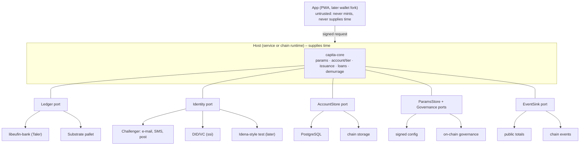
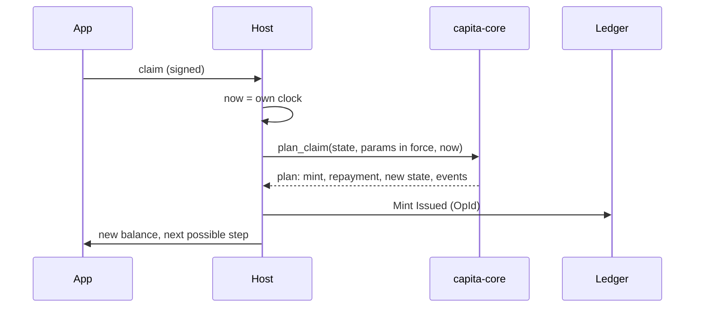

# Capita Money – architecture

Status: M2, first half (2026-11-13) – rules implemented and tested in `capita-core`; chain host as `pallet-capita`, tested against a mock runtime. Scope: how the parts fit, where trust lies, what can go wrong.
Rules still open are marked `Offene Frage:`; they are parameters or hooks, never decided in code.

## 1. Principle

All monetary rules live in one pure library, `capita-core`. It computes; it does not store, send or read a clock.
Everything else is an adapter behind a port. Two hosts run the same core:

- **Service host** (first): a small service next to a GNU Taler bank (libeufin-bank).
- **Chain host** (later): a Substrate pallet on an own chain with Duniter pallets.

Same rules, same tests, either host. Swapping ledger or identity provider touches one adapter, never the rules.

## 2. Components

| Part | Role | Repository path |
|---|---|---|
| `capita-core` | rules, data model, ports | `crates/capita-core` |
| service host + Taler adapters | claim/lend API, outbox, libeufin client | M4 |
| `pallet-capita` | same core inside a runtime (ADR 0009) | `pallets/capita` |
| runtime + node | local test chain | M2, open |
| identity adapters | attestations from providers | M3 |
| app, website | user interface | M5 |
| messaging, content distribution | later ports (libp2p, iroh) | – |

Core modules: `types` (money, time, ids) · `params` (versioned rules, validation) · `account` (state per account) · `attributes` (attestation, sponsor filter) · `plan` · `lifecycle` (open, verify, step, freeze/close) · `issuance` (claim, purchase) · `loans` (payments, credit lines, recorded loans) · `demurrage` · `totals` · `ports` · `errors`.

## 3. Plan, then apply

Every rule function is pure: `plan_*(state, params in force, now, …) -> Plan`.
A plan holds the new account state, the ledger operations and the events. The host applies it.
What the identity provider attests (level, validity, residence) is copied into the account state by `plan_attest`; a claim therefore needs no call to the provider.
Nothing is half-done: either the whole plan is applied or none of it.

- Chain host: one extrinsic = one storage transaction. Atomic by construction.
- Service host: database and bank are two systems. Order: (1) one database transaction stores the new state and the pending operations (outbox); (2) operations go to the bank with their `OpId`; (3) marked done. A crash between (1) and (3) is repaired by resending – the bank applies each `OpId` once.

## 4. Data flows

### Claim (issuance)

1. Host loads account state, attestation and all parameter versions in force since the last claim.
2. Core checks: account active, time not backwards, verification level still valid (expiry is a moment in time like any other change).
3. Entitlement = rate(step) × time since anchor, rounded down, minus what was already paid; rate limited by the cap of the account; time limited by the claim window (older entitlement lapses). A change of parameters, an expiring verification or a step of the seniority ramp splits the period at that moment. A change of step, level, residence or status first sets aside what accrued so far (`carried`), so no change reaches back.
4. With debt outstanding, a share of the claim (`repayment_share`) goes to repayment.
5. Plan applied (section 3).

Offene Frage: B4 claim or automatic. Default claim; "automatic" is the host calling the same function on a schedule – no core change.
Offene Frage: A1d ripening. Hook: issued money is minted only once ripe (delayed mint: a claim at `now` covers the time up to `now` − ripening), so no ledger needs a second balance. Default zero = at once. Unripe money is not on the ledger and so cannot be lent.

### Open an account, verify
`plan_open`: lowest step of the ladder and the one-time start grant. The grant is earmarked (`start_grant_reserved`): it can be paid only to the verification service, for the verification of the account itself (`plan_spend_start_grant`) – not to anybody else, not as a loan, and no demurrage is charged on it. The identity adapter then reports what it found (`plan_attest`), and the holder moves up the ladder (`plan_set_tier`).

### Purchase (euro → Capita, one way)
Payment handling is outside the core. After the payment is confirmed, the host requests `Mint Purchased`. No operation exists for the way back.

### Pay
A transfer between two accounts (`plan_payment`). On the chain host and for bank-internal transfers the core checks: both accounts active, balance stays above minus the credit line, demurrage settled first on both sides (if on: the host calls `plan_demurrage` for each account, then the payment).
With Taler, money withdrawn into a wallet is digital cash: payments from the wallet are private and bypass the core by design (see 5).

### Lend
Interest-free only – the data model has no interest field.
A loan is a credit line on the borrower's account (`plan_set_credit_line`), or a transfer from a lender with the debt recorded in the borrower's state (`plan_lend`; one lender per borrower at a time). A share of each claim goes on to the lender; `plan_repay` repays voluntarily. Details: ADR 0006.
Offene Frage: C1 who lends · C2 fees (default none) · C3 default handling (default: deduct from future issuance) · C4 maximum amount and term.

### Change of rules
New `Params` version through the governance port: valid in itself, higher version, start time not in the past (`Params::validate_successor`), valid authorization. Never retroactive – otherwise the moment of a claim would change its result.
Offene Frage: E1 who may change rules.

## 5. Trust boundaries

| Zone | Trusted for | Not trusted for | Safeguard |
|---|---|---|---|
| Device, app | signing the owner's requests | time, amounts, step | every number computed by core on host |
| Host | running the published core, honest time | – (service: one operator; chain: consensus) | open source, public events and totals, Taler auditor; later chain |
| Ledger | balances, applying each `OpId` once | deciding rules | `centralbank` account with debit limit, never `admin` |
| Identity providers | one person = one `PersonId`, attributes | money | derived facts only; provider list in governance; swappable |
| Governance | changing parameters | changing past results | versions, no retroactive start |
| Taler wallet (digital cash) | private payments | – | rules end at withdrawal: demurrage and ripening cannot reach coins in a wallet (ADR 0004) |

Personal data never enters the core, the events or the ledger subjects: the core sees `PersonId` (opaque), a verification level, a country and numbered attributes.

## 6. Threat model

| Threat | Countermeasure | Where | Test (M1) |
|---|---|---|---|
| Double claim (parallel requests) | compare-and-swap on `revision`; entitlement derived from stored anchor, so a second claim finds nothing | core + AccountStore | two partial claims = one claim |
| Replay of a request or operation | `OpId` = account + sequence number; ledger applies once | core + Ledger | same plan applied twice changes nothing |
| Clock manipulation on device | device time never used | host | – |
| Clock set back on host | `now` < `last_seen` → error | core | time backwards → error |
| Clock set forward on host | claim window limits the damage; public events expose it | core + audit | claim ≤ rate × window |
| Overflow, rounding drift | integer cents, checked arithmetic, u128 intermediates, round down, remainder carried | core, lints | no overflow at maximum values; sums exact |
| Duplicate accounts | `PersonId` unique; `account_of(person)` before linking; freeze on suspicion; ripening withheld | Identity + core | frozen/closed accounts get nothing |
| Stale or revoked attestation | expiry checked at each claim; step falls back | core | – |
| Rule change by one person | governance port; versioned, public, not retroactive | Governance | version and start time checks |
| `centralbank` credentials stolen | debit limit caps the damage; separate from `admin`; totals vs. events alarm | Ledger adapter | total supply = issued − burnt |
| Hidden sponsor criteria | filters only over keys published in `Params::sponsor_keys` | core | filter with unknown key rejected |
| Debt beyond the credit line | ledger refuses; core checks in plan | core + Ledger | balance never below −credit line |
| Lost device | account bound to verified person, not to a key alone; re-verification restores access | Identity adapter | – |

Out of scope for the core: denial of service, network security, operator key management (M4), legal classification (P04.3).

## 7. Open rule questions carried as parameters or hooks

A1d ripening · A2 target level · A2b residence details · A3 final stage · B2 demurrage · B3/B3a supply vs. market (hook: step unlock gated by market size, default no gate) · B4 claim vs. automatic · B5 death, exit, duplicate (states active/frozen/closed + policy hook) · B6 minimum age · C1–C4 lending · E1 governance · E3 transparency · F3 identity provider.
